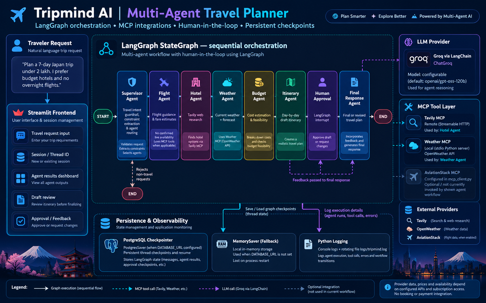
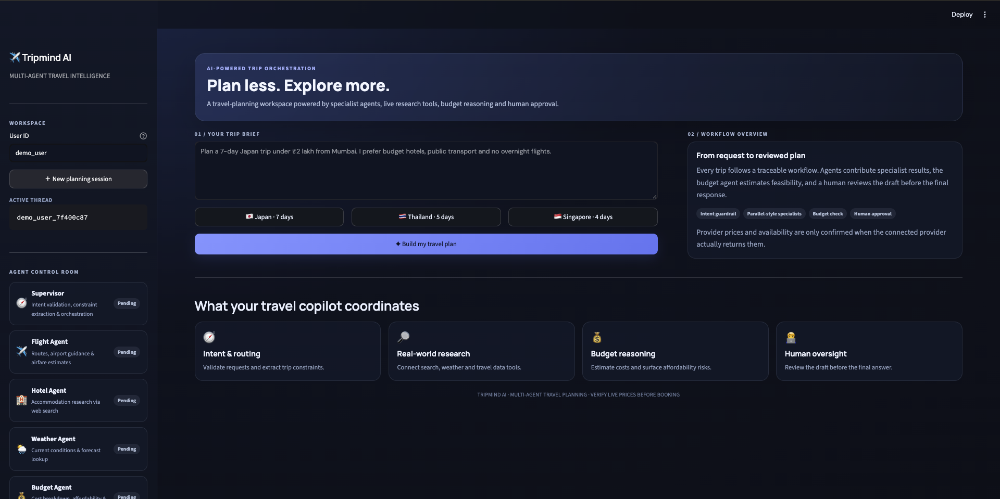
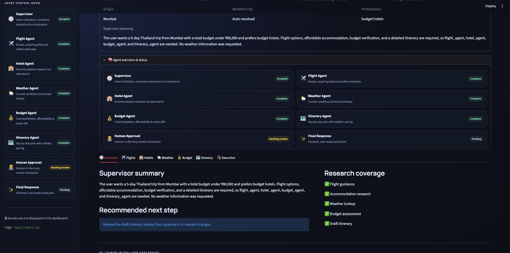
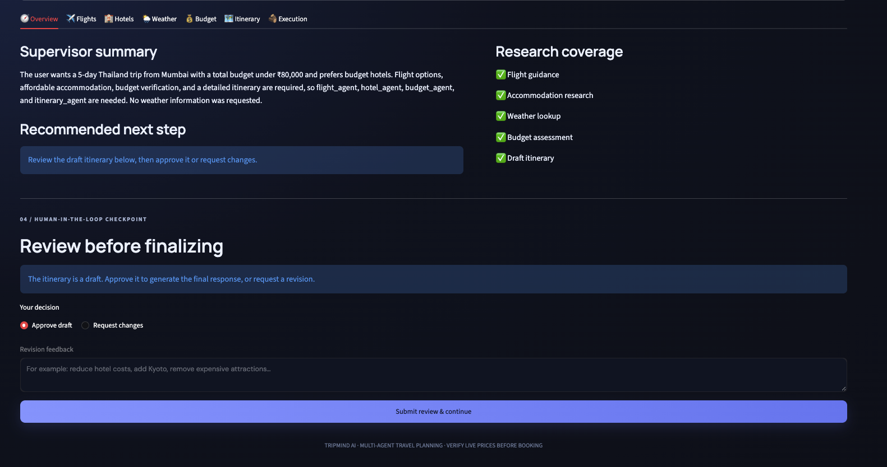

# ✈️ Tripmind AI --- Multi-Agent Travel Planner

> A real-world GenAI travel-planning application built with **LangGraph,
> Groq, MCP, Streamlit, and PostgreSQL**. It coordinates specialist
> agents to research a trip, estimate its budget, draft an itinerary,
> and request human approval before producing the final plan.



## ✨ Overview

Tripmind AI turns a natural-language travel request into a structured
travel plan. A LangGraph workflow coordinates specialist agents, shares
state between steps, calls external tools through the Model Context
Protocol (MCP), and pauses for human review before finalizing the
response.

Example request:

> Plan a 7-day Japan trip under ₹2 lakh from Mumbai. I prefer budget
> hotels, public transport, and no overnight flights.

## 🧩 Key Features

-   **Multi-agent orchestration:** LangGraph `StateGraph` coordinates
    the workflow.
-   **Supervisor and guardrail:** Validates travel intent, extracts
    constraints, and selects specialist agents.
-   **Specialist agents:** Flight, Hotel, Weather, Budget, and
    Itinerary.
-   **MCP integrations:** External tools are exposed through the Model
    Context Protocol.
-   **Budget reasoning:** Estimates trip costs and highlights
    affordability concerns. Estimates are not confirmed quotes.
-   **Human-in-the-loop:** LangGraph interrupt pauses the workflow so a
    user can approve a draft or request changes.
-   **Persistent workflow state:** PostgreSQL checkpointer when
    `DATABASE_URL` is configured; `MemorySaver` fallback for local
    development.
-   **Observability:** Python logging to the console and rotating
    `logs/tripmind.log`.
-   **Streamlit dashboard:** Displays constraints, agent status,
    research outputs, budget, itinerary, approval, and final response.


## 🏗️ Architecture


``` text
Traveler
   |
   v
Streamlit Frontend
   |
   v
LangGraph Supervisor
   |-- validates travel intent
   |-- extracts trip constraints
   |-- selects agents
   |
   v
Flight Agent
   |
   v
Hotel Agent ------> Tavily MCP
   |
   v
Weather Agent ----> Weather MCP ----> OpenWeather API
   |
   v
Budget Agent
   |
   v
Itinerary Agent
   |
   v
Human Approval
   | approved / changes requested
   v
Final Response
```

### Agent responsibilities

  -----------------------------------------------------------------------
  Agent                               Responsibility
  ----------------------------------- -----------------------------------
  Supervisor                          Validates travel intent, extracts
                                      constraints, and selects agents

  Flight Agent                        Provides flight guidance and
                                      airfare estimates; live data
                                      depends on the configured provider
                                      and implementation

  Hotel Agent                         Researches accommodation options
                                      using Tavily search

  Weather Agent                       Retrieves current weather and
                                      forecast information

  Budget Agent                        Estimates costs and assesses budget
                                      feasibility

  Itinerary Agent                     Creates a day-by-day draft
                                      itinerary

  Human Approval                      Pauses for approval or revision
                                      feedback

  Final Response                      Produces the final or revised
                                      travel response
  -----------------------------------------------------------------------

### MCP integrations

  -----------------------------------------------------------------------
  MCP server              Transport / role        Provider
  ----------------------- ----------------------- -----------------------
  Tavily MCP              Remote Streamable HTTP  Web search and research

  Weather MCP             Local stdio Python      OpenWeather current
                          server                  weather and forecast

  AviationStack MCP       Local stdio Python      Aviation data tools;
                          package                 availability depends on
                                                  subscription and
                                                  whether the workflow
                                                  invokes those tools
  -----------------------------------------------------------------------

### AviationStack MCP setup

Clone the AviationStack MCP repository:

``` bash
git clone https://github.com/Pradumnasaraf/aviationstack-mcp.git
```

This creates an `aviationstack-mcp/` directory. Follow that repository's
README for its dependencies, configuration, and supported tools. Ensure
the Python environment used by `mcp_client.py` can import
`aviationstack_mcp`.


## 🛠️ Technology Stack

  -----------------------------------------------------------------------
  Layer                               Technologies
  ----------------------------------- -----------------------------------
  Language                            Python

  Frontend                            Streamlit

  Agent orchestration                 LangGraph

  LLM integration                     LangChain, Groq

  Model                               Configurable using `GROQ_MODEL`;
                                      current config default is
                                      `openai/gpt-oss-120b`

  Tool integration                    MCP, `langchain-mcp-adapters`

  Web research                        Tavily

  Weather                             OpenWeather API

  Flight data integration             AviationStack MCP, subject to
                                      plan/tool availability

  Workflow persistence                PostgreSQL, LangGraph Postgres
                                      checkpointer

  Local fallback                      LangGraph MemorySaver

  Logging                             Python `logging`, rotating file
                                      handler
  -----------------------------------------------------------------------


## ⚙️ Prerequisites

-   Python 3.12 or a compatible version supported by the installed
    dependencies
-   Git
-   Groq API key
-   Tavily API key
-   OpenWeather API key
-   AviationStack API key if using its MCP tools
-   PostgreSQL for persistent LangGraph checkpoints (optional for local
    development)

## 🚀 Local Setup

### 1. Clone your Tripmind AI repository

``` bash
git clone https://github.com/CodeCortex/tripmind-ai.git
cd tripmind-ai
```


### 2. Create and activate a virtual environment

``` bash
python3 -m venv .venv
source .venv/bin/activate
```

### 3. Install dependencies

``` bash
python -m pip install --upgrade pip
pip install -r requirements.txt
```

To clone and work with AviationStack MCP locally:

``` bash
git clone https://github.com/Pradumnasaraf/aviationstack-mcp.git
```

### 4. Configure environment variables

``` bash
cp .env.example .env
```

``` dotenv
GROQ_API_KEY=your_groq_api_key
GROQ_MODEL=openai/gpt-oss-120b

TAVILY_API_KEY=your_tavily_api_key
OPENWEATHER_API_KEY=your_openweather_api_key
AVIATION_STACK_API_KEY=your_aviationstack_api_key

# Optional: persistent LangGraph checkpoint database
DATABASE_URL=

```


### 5. Run the application

``` bash
streamlit run frontend.py
```

Open `http://localhost:8501`.







## 📊 Logging and Observability

The application uses centralized Python logging:

-   Rotating file output at `logs/tripmind.log`.

## 🧑‍💻 Human-in-the-Loop Workflow

The Itinerary Agent creates a draft. The Human Approval node uses a
LangGraph interrupt to pause execution. The user can:

1.  Approve the draft and continue to the final response.
2.  Request changes and provide feedback.

The frontend resumes the workflow using the same `thread_id`. The checkpointer preserves the
interrupted graph state so execution can continue.

## 👨‍💻 Author

**Roshan Jaiswal**

GenAI • Agentic AI • Python • LangGraph • MCP • RAG • LLM Applications

------------------------------------------------------------------------

If you find this project useful, consider giving the repository a ⭐.
